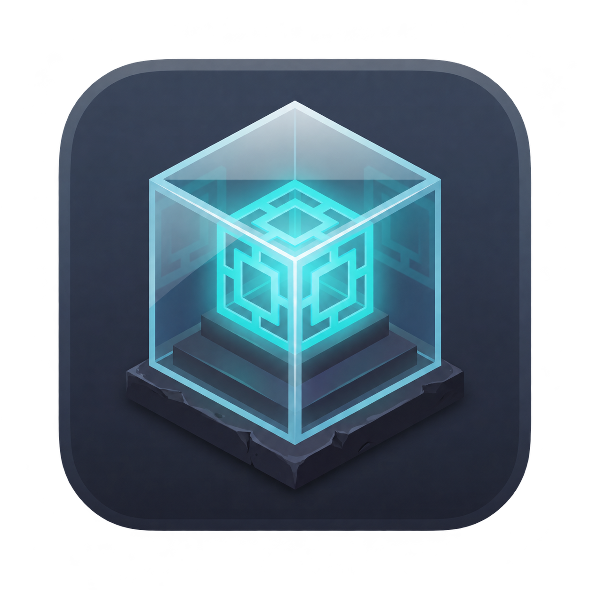
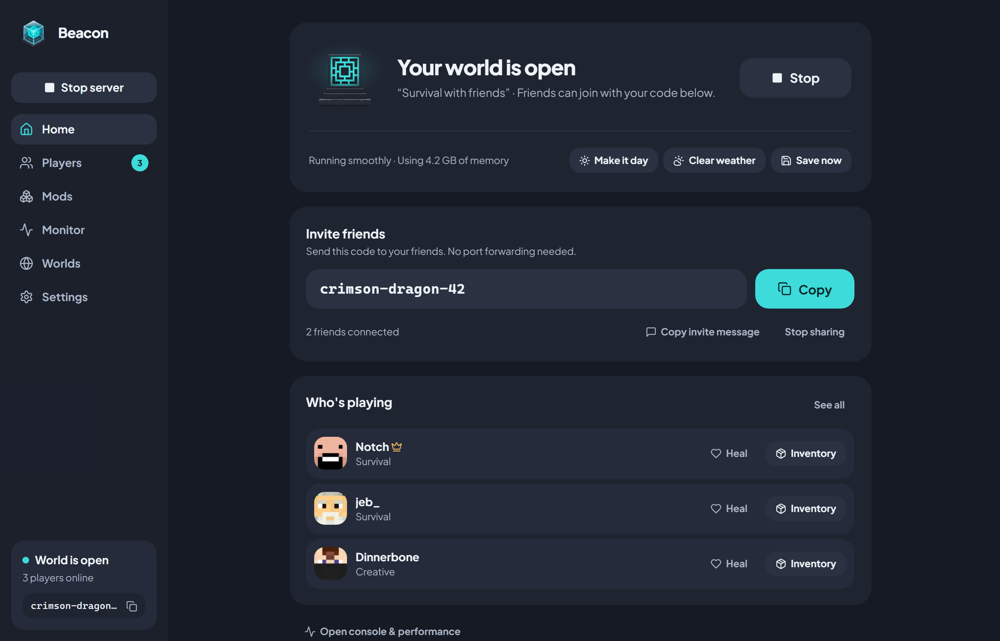
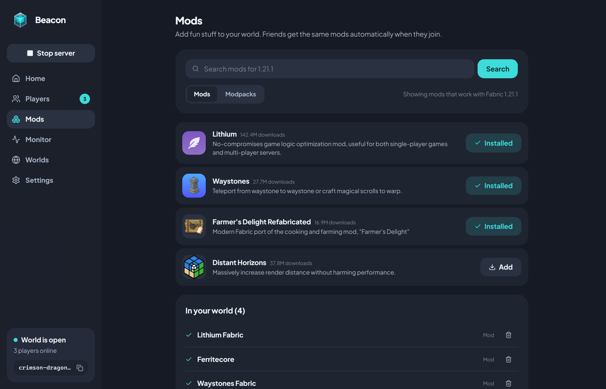
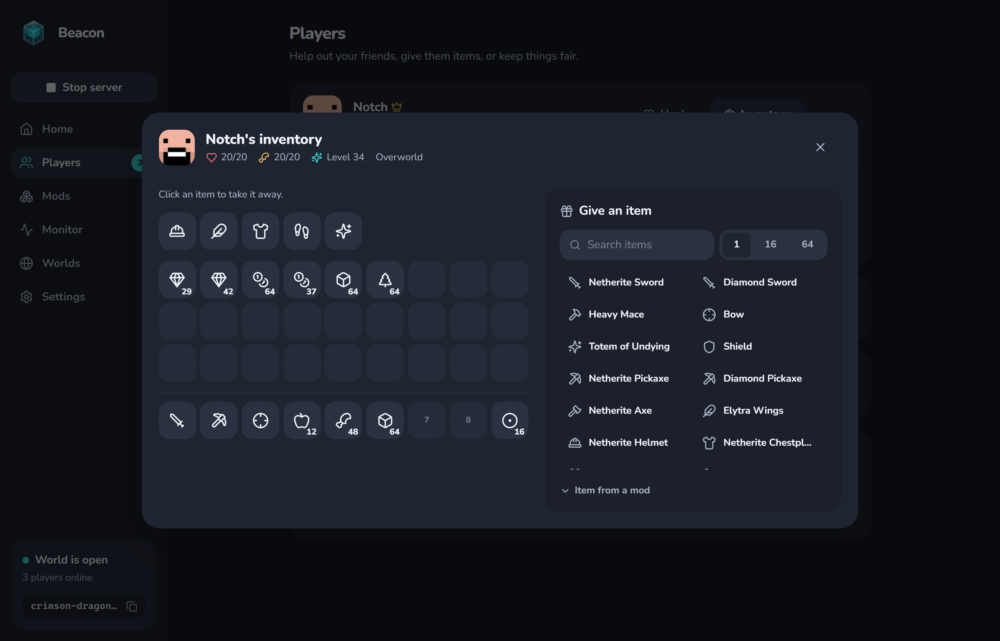
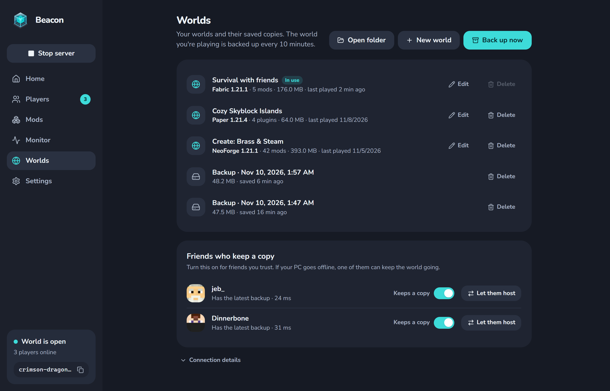
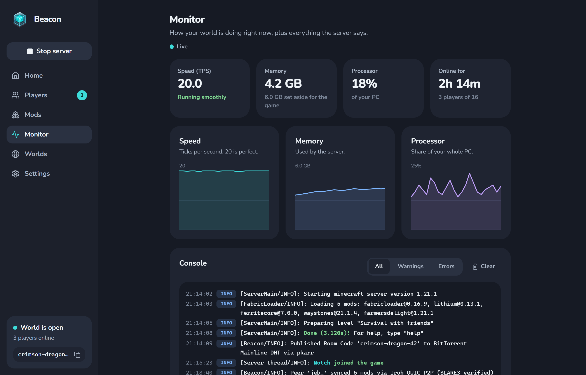
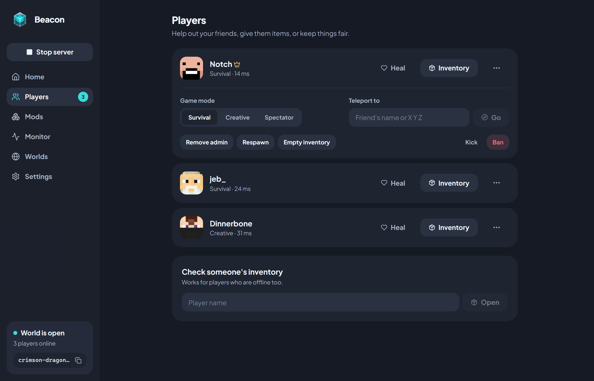
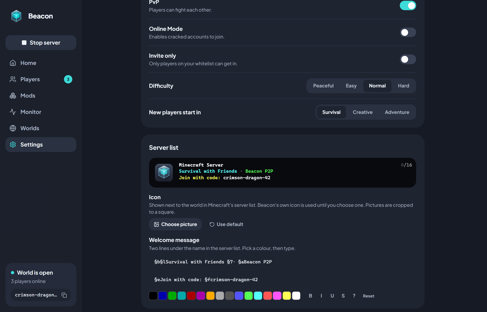

<div align="center">



# Beacon

**Minecraft with friends, without the hassle.**

Turn your PC into a Minecraft server in one click. Share a short code, your friends hop in.<br />
No port forwarding. No VPNs. No monthly bills.

[](LICENSE)
[](https://github.com/Sezergumus/beacon/releases/latest)


[**Download**](https://github.com/Sezergumus/beacon/releases/latest) ·
[How it works](#-how-it-works) ·
[Features](#-features) ·
[FAQ](#-faq) ·
[Build from source](#-build-from-source)

<br />



</div>

<br />

## ✨ How it works

|   | |
|---|---|
| **1. Press Start** | Pick a world and hit Start. Beacon sets up Java and everything else for you. |
| **2. Share your code** | You get a friendly three-word code like `crimson-dragon-42`. Send it to your friends. |
| **3. Friends join** | They paste the code into Beacon, and your world shows up under **Multiplayer → LAN Worlds** in Minecraft. |

That's it. No IP addresses, no router settings, nothing to rent.

## 🎮 Features

### One-click servers
- **Java is handled for you.** Beacon downloads a portable Java 21 runtime the first time you need it.
- **Smart memory settings.** RAM and Java launch flags are picked from your hardware.
- **Pick your flavor:** **Paper** (plugins), **Fabric** or **NeoForge**.
- **Runs quietly in the tray,** so closing the window doesn't end your game. Beacon also shuts the server down cleanly so worlds never get corrupted.

### Play together, from anywhere
- **Room codes instead of IP addresses.** Friends connect to you directly, peer to peer, even behind strict routers or CGNAT.
- **Shows up as a LAN world.** Friends just open Minecraft and click Join.
- **Nothing to host.** There is no Beacon server: it's your PC and your friends' PCs.

### Mods that just work



- Search **Modrinth** and add mods, plugins or whole modpacks in a click.
- When friends join, Beacon gives them the **exact same mods automatically**.

### Look after your friends



- Heal or feed someone, switch game modes, teleport, kick or ban, all without memorizing commands.
- **Peek into any player's inventory** (online or offline), take items away, or **give any item** from a searchable list of every vanilla item, with real Minecraft icons.
- Make it day, clear the weather, or save the world with a button.

### Your world stays safe



- **Automatic backups** every 10 minutes.
- Friends you trust can **keep a copy**, so the world keeps going even when your PC is off.
- Smooth **handover** to another host, and automatic **failover** if the host's PC crashes.

### See what's going on



- A live console and performance charts, in plain language.
- Game rules, difficulty, view distance, whitelist and more as simple switches.

<details>
<summary><b>More screenshots</b></summary>
<br />


<br /><br />


</details>

## 🙋 FAQ

<details>
<summary><b>Is it really free?</b></summary>
<br />
Yes. The server runs on your own PC and friends connect to you directly, so there is nothing to rent and no subscription. Beacon is free and open source.
</details>

<details>
<summary><b>Do my friends need Beacon too?</b></summary>
<br />
Yes, it's the same small app. They type in your code, Beacon connects them and syncs any mods, then they just open Minecraft.
</details>

<details>
<summary><b>Which Minecraft works with it?</b></summary>
<br />
Minecraft: Java Edition. You can host plain, plugin (Paper), Fabric or NeoForge worlds.
</details>

<details>
<summary><b>Windows shows a warning when I open it</b></summary>
<br />
Beacon isn't code-signed yet, so SmartScreen may ask on first launch. Click <b>More info</b> → <b>Run anyway</b>.
</details>

## 🔧 Under the hood

Beacon is a single desktop app that is both the **host** and the **guest**.

| Piece | How it works |
|---|---|
| **App shell** | [Tauri v2](https://tauri.app) (Rust) with a React 19 + TypeScript + Tailwind interface. No Electron, no Docker. |
| **Game server** | The Minecraft server runs as a child process managed from Rust, with a portable Java 21 from [Adoptium](https://adoptium.net). |
| **Room codes** | A three-word code derives a key pair; the host's address is published to the BitTorrent Mainline DHT with [pkarr](https://github.com/pubky/pkarr). No central server. |
| **Connection** | [iroh](https://iroh.computer) (QUIC) punches through NAT and carries the game traffic and a small control channel. |
| **Mods and content** | [Modrinth](https://modrinth.com) for search and downloads, with hash checks. Custom files travel directly from the host. |
| **Inventories** | Player data files are watched and read live (NBT), so what you see is what they carry. |
| **Backups** | World snapshots are compressed with Zstandard and replicated to trusted co-hosts. |

## 🛠 Build from source

You'll need [Node.js](https://nodejs.org), the [Rust toolchain](https://rustup.rs) and the
[Tauri prerequisites](https://tauri.app/start/prerequisites/) for your OS.

```bash
# Install dependencies
npm install

# Run the app in development mode
npm start

# Type-check and build the web part
npm run build

# Build the installer
npm run tauri build

# Run the Rust tests
cargo test --manifest-path src-tauri/Cargo.toml
```

<details>
<summary><b>Project layout</b></summary>

```
src/                 React interface (screens in src/components/*)
src-tauri/src/
  engine/            Java, server process, worlds, properties, inventory reader
  network/           Room codes, peer-to-peer connection, LAN broadcast, host migration
  content/           Modrinth search/install and mod syncing
website/             The landing page
public/items/        Item icons used by the inventory window
scripts/             Helpers, e.g. `npm run items:generate` rebuilds the item list and icons
```

</details>

## 📄 License

Beacon's source code is free software under the **[GNU General Public License v3.0](LICENSE)**. You may use,
study, change and share it; anything you distribute that is based on it must also be released under GPL-3.0
with its source code. The license covers the code only, not the Minecraft artwork described below.

## ⚖️ Legal

Beacon is a free, non-commercial fan project. It is **not an official Minecraft product and is not approved
by or associated with Mojang or Microsoft.** "Minecraft" is a trademark of Mojang AB / Microsoft.

The Minecraft item icons in `public/items/` are Mojang's artwork (some via the Minecraft Wiki, CC BY-NC-SA 3.0)
and are not covered by this project's license. See [NOTICE.md](NOTICE.md) for sources and credits.
